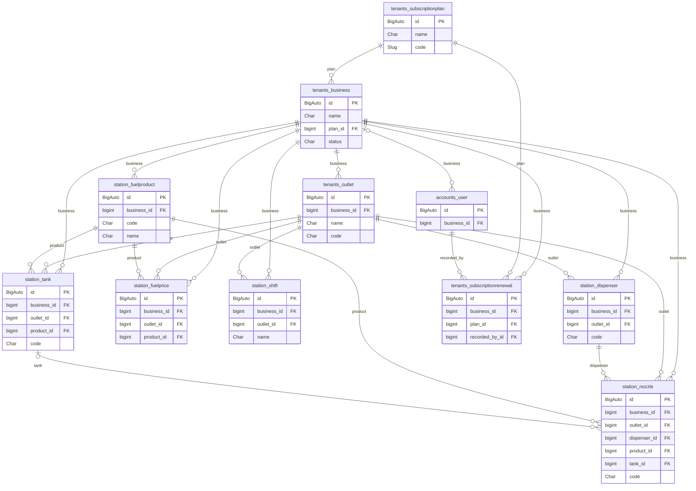
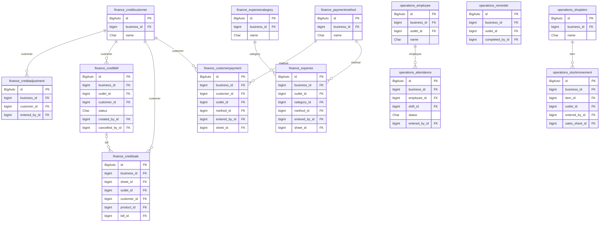

# Entity Relationship Diagrams

*Generated from the Django models on 18 October 2026 by `documentation/tools/generate_schema_docs.py`.*

Mermaid `erDiagram` notation: `||--o{` means one to many. Only primary keys, foreign keys and a few key columns are shown; Appendix A lists every column. The `business` link that every table has is shown only in Figure 3.8a to keep the other diagrams readable.

To turn a diagram into an image for the report: paste it into <https://mermaid.live> and use *Actions → PNG*, or preview it in VS Code with a Mermaid extension.

## Figure 3.8a: Tenants, users and outlet set-up

## Figure 3.8b: Shift Cards, stock and purchases

```mermaid
erDiagram
    purchases_fuelpurchase {
        BigAuto id PK
        bigint business_id FK
        bigint outlet_id FK
        bigint supplier_id FK
        Char invoice_number
        bigint entered_by_id FK
    }
    purchases_purchaseline {
        BigAuto id PK
        bigint business_id FK
        bigint purchase_id FK
        bigint product_id FK
        bigint tank_id FK
    }
    purchases_supplier {
        BigAuto id PK
        bigint business_id FK
        Char name
    }
    sales_correctionline {
        BigAuto id PK
        bigint business_id FK
        bigint correction_id FK
        bigint line_id FK
        bigint next_line_id FK
    }
    sales_dailysalesline {
        BigAuto id PK
        bigint business_id FK
        bigint sheet_id FK
        bigint nozzle_id FK
        bigint product_id FK
        bigint tank_id FK
    }
    sales_dailysalessheet {
        BigAuto id PK
        bigint business_id FK
        bigint outlet_id FK
        bigint shift_id FK
        Date business_date
        bigint dispenser_id FK
        bigint employee_id FK
        bigint entered_by_id FK
        bigint updated_by_id FK
    }
    sales_salescorrection {
        BigAuto id PK
        bigint business_id FK
        bigint sheet_id FK
        Char status
        bigint requested_by_id FK
    }
    stock_stockline {
        BigAuto id PK
        bigint business_id FK
        bigint sheet_id FK
        bigint tank_id FK
        bigint product_id FK
    }
    stock_stocksheet {
        BigAuto id PK
        bigint business_id FK
        bigint outlet_id FK
        Date business_date
        bigint entered_by_id FK
        bigint updated_by_id FK
    }
    stock_tankreceipt {
        BigAuto id PK
        bigint business_id FK
        bigint outlet_id FK
        bigint tank_id FK
        bigint entered_by_id FK
        bigint purchase_id FK
    }
    purchases_supplier ||--o{ purchases_fuelpurchase : "supplier"
    purchases_fuelpurchase ||--o{ purchases_purchaseline : "purchase"
    sales_salescorrection ||--o{ sales_correctionline : "correction"
    sales_dailysalesline ||--o{ sales_correctionline : "line"
    sales_dailysalesline o|--o{ sales_correctionline : "next_line"
    sales_dailysalessheet ||--o{ sales_dailysalesline : "sheet"
    sales_dailysalessheet ||--o{ sales_salescorrection : "sheet"
    stock_stocksheet ||--o{ stock_stockline : "sheet"
    purchases_fuelpurchase o|--o{ stock_tankreceipt : "purchase"
```

## Figure 3.8c: Credit, expenses and operations

