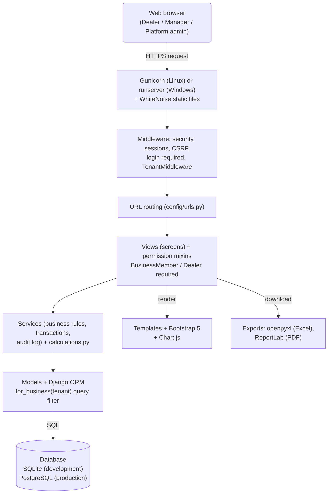
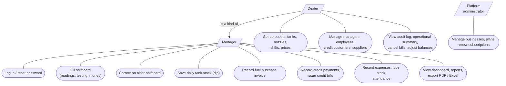
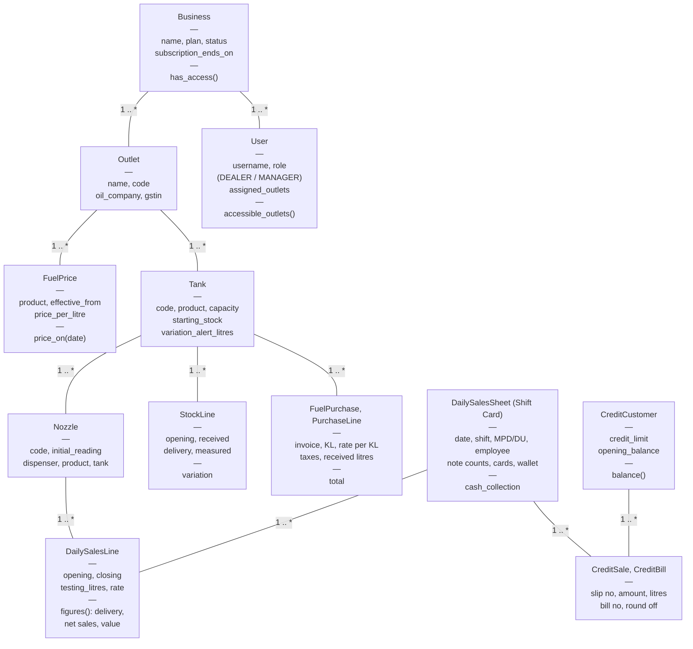
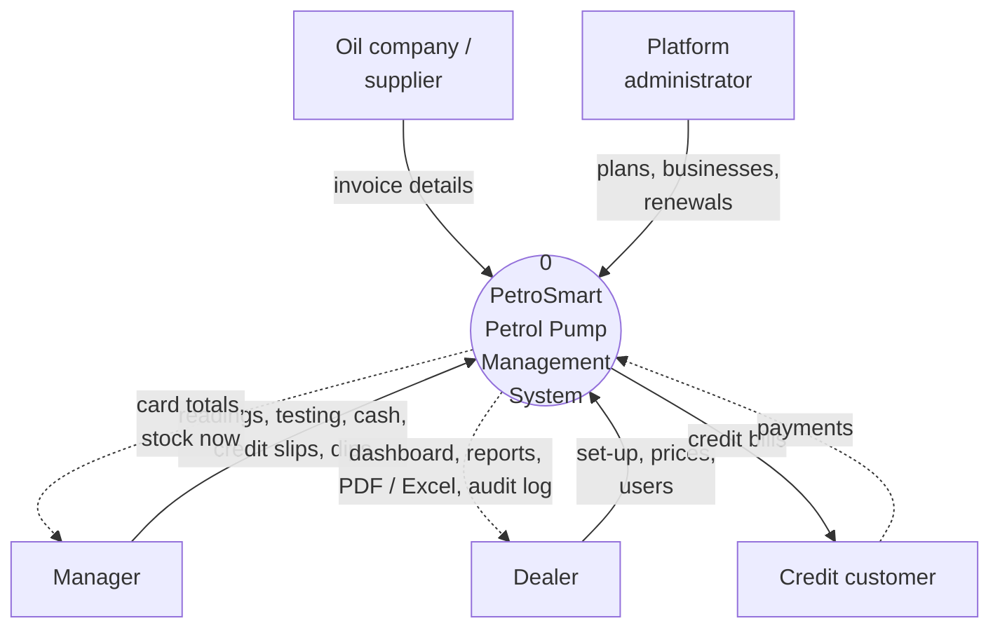
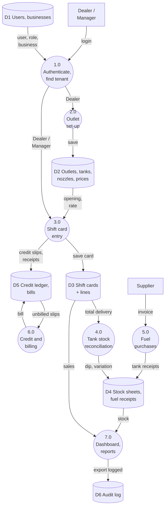
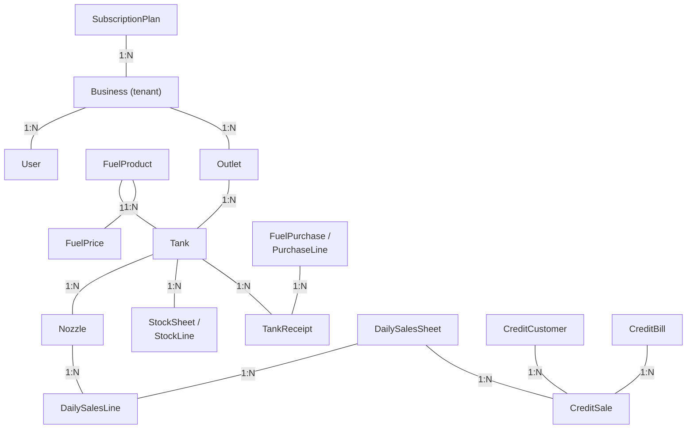

# UML diagrams and data flow diagrams (editable Mermaid)

*Generated by `documentation/tools/diagrams.py`, which also draws these figures in the PDF report. Edit the diagrams in that file, then rerun it and `build_report.py`.*

## Figure 3.1: System architecture (Django MVT, multi-tenant)



## Figure 3.2: Use-case diagram



The hollow arrow means the Dealer can do everything a Manager can, plus the set-up and control tasks. A Manager works only at the outlets the Dealer assigns. The platform administrator manages tenants only, on a separate admin site.

## Figure 3.3: Class diagram (main classes)



Every class except User and Business inherits TenantOwnedModel, which adds the business (tenant) link and the for_business() query filter.

## Figure 3.4: Activity diagram: filling and saving a Shift Card

```mermaid
flowchart TB
    start(("start"))
    a1("Manager chooses date, shift and MPD / DU")
    a2("System loads pump rows: opening = previous<br/>closing, rate = price in force on the date")
    d1{"Readings in<br/>order and<br/>price set?"}
    e1("Show reason;<br/>card cannot<br/>start")
    a3("Enter closing readings, testing litres,<br/>note counts, cards, wallet, credit slips,<br/>lube, receipts, expenses")
    a4("Live totals on screen: Sale Ltr, Net Ltr,<br/>Sale Rs, cash to collect, balance / short")
    d2{"Server<br/>checks<br/>pass?"}
    e2("Show errors;<br/>nothing saved")
    a5("Save in one transaction: card, lines, slips,<br/>receipts, lube sales, expenses + audit log")
    a6("Tank 'stock now' drops by total delivery")
    end(("end"))
    start --> a1
    a1 --> a2
    a2 --> d1
    d1 -->|"no"| e1
    d1 -->|"yes"| a3
    a3 --> a4
    a4 -->|"Save"| d2
    d2 -->|"no"| e2
    e2 -.->|"correct and save again"| a3
    d2 -->|"yes"| a5
    a5 --> a6
    a6 --> end
```

Server checks: closing ≥ opening (unless a documented meter reset), 0 ≤ testing ≤ delivery, pump rows match the MPD / DU, enough lube in stock, the date's tank stock not yet saved.

## Figure 3.5: Sequence diagram: saving a Shift Card

```mermaid
sequenceDiagram
    participant Manager as Manager
    participant Browser as Browser
    participant CardFormView as CardFormView
    participant services_save_card as services.save_card
    participant Database as Database
    participant AuditLog as AuditLog
    Manager->>Browser: Click Save
    Browser->>CardFormView: POST /sales/new/ (+ CSRF token)
    CardFormView->>CardFormView: Check login, role, outlet; validate forms
    CardFormView->>services_save_card: save_card(user, header, rows, ...)
    services_save_card->>Database: BEGIN; check order, stock lock, rows
    services_save_card->>Database: INSERT card, lines, slips, receipts ...
    services_save_card->>AuditLog: record(CREATE, figures)
    services_save_card->>Database: COMMIT
    services_save_card-->>CardFormView: sheet, warnings
    CardFormView-->>Browser: 302 redirect to card + messages
    Browser-->>Manager: Card page: totals, balance / short, stock now
```

## Figure 3.6: Data flow diagram, Level 0 (context diagram)



## Figure 3.7: Data flow diagram, Level 1



Every process also writes to D6 (Audit log) when it changes data; only one such arrow is drawn.

## Figure 3.8: Entity relationship diagram (simplified; full ERDs in documentation/diagrams/erd.md)



1:N means one row on the first side has many rows on the other. Every entity except SubscriptionPlan also belongs to one Business; those links are left out for clarity.
